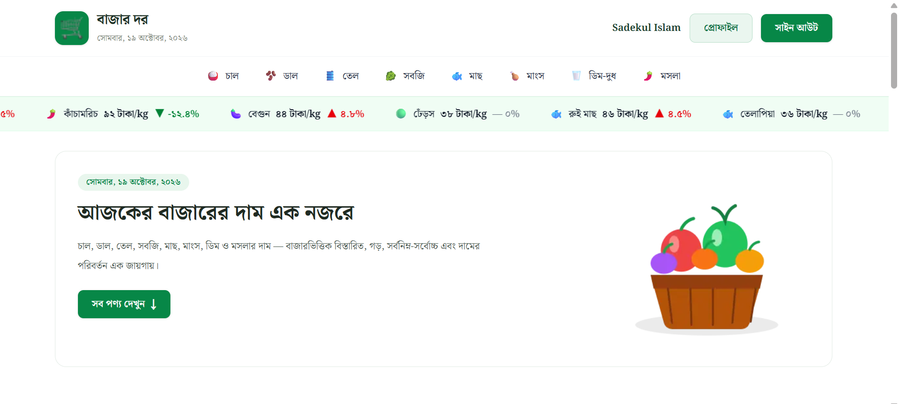

# 🛒 Bazar Dor — Daily Market Price Tracker

A modern and responsive Bengali market price tracking website built with **Next.js App Router, TypeScript, Tailwind CSS, DaisyUI, Better Auth, and MongoDB**.

**Bazar Dor (বাজার দর)** allows users to explore daily grocery prices in Bangladesh, track price increases and decreases, browse products by category, and compare prices across different markets through a clean Bengali interface.

---

## 🌐 Live Demo

🔗 **Live Website:** https://bazar-dor-tracker-a7.vercel.app/

🔗 **GitHub Repository:** https://github.com/Sadekul21/Bazar-Dor-Tracker-A7

---

## 📸 Project Preview



---

## 📖 About the Project

**Bazar Dor** is a Bengali-language market price tracking application built with **Next.js**.

Users can browse everyday grocery items such as rice, lentils, oil, vegetables, fish, meat, eggs, and spices. The application displays daily prices, price changes, category-based product listings, and market-wise price comparisons.

Registered users can sign in using email and password, Google, or GitHub to access detailed product information.

I built this project as part of my learning journey in **full-stack web development**, focusing on Next.js App Router, TypeScript, REST API integration, authentication, database integration, protected routes, reusable components, responsive design, and production deployment.

---

## ✨ Features

- 🛒 **Daily Market Prices** — Browse essential grocery products with current prices fetched from an external REST API.
- 📢 **Latest Price Ticker** — Scrolling marquee displaying product prices and price changes.
- 📈 **Price Increases** — View the top six products with the highest price increases.
- 📉 **Price Decreases** — View the top six products with the highest price decreases.
- 🗂️ **Category Navigation** — Browse products from eight different grocery categories.
- 🔀 **Price Sorting** — Sort products by price from low to high or high to low.
- 🧾 **Product Details** — View product name, category, unit, daily price, and price change percentage.
- 📊 **Market Price Comparison** — Compare minimum, maximum, and average prices across markets.
- 🔐 **Email & Password Authentication** — Secure registration and login using Better Auth.
- 🌐 **Google & GitHub Login** — Social authentication through OAuth providers.
- 👤 **User Profile** — View user information and update the account name.
- 🚪 **Sign Out** — End the current user session securely.
- 🛡️ **Protected Product Details** — Require authentication before accessing product details.
- 🔔 **Toast Notifications** — Success and error feedback for authentication and profile actions.
- ⏳ **Loading Skeletons** — Display loading placeholders while pages are loading.
- 🚫 **Custom 404 Page** — User-friendly page for invalid routes.
- 📭 **Empty States** — Helpful messages when categories contain no products.
- 📱 **Responsive Design** — Optimized for mobile, tablet, and desktop screens.
- 🇧🇩 **Bengali Interface** — Bengali text, localized numbers, and Bangladesh date formatting.

---

## 🛠️ Tech Stack

| Technology | Purpose |
| --- | --- |
| ▲ Next.js 16 | Main framework and App Router |
| ⚛️ React | Reusable UI components |
| 🔷 TypeScript | Type-safe development |
| 🎨 Tailwind CSS 4 | Styling and responsive design |
| 🌼 DaisyUI | UI and form component utilities |
| 🔐 Better Auth | Authentication and session management |
| 🍃 MongoDB | Database for users, accounts, and sessions |
| 🔗 MongoDB Adapter | Connecting Better Auth with MongoDB |
| 🌐 Google OAuth | Google authentication |
| 🐙 GitHub OAuth | GitHub authentication |
| 🔔 React Hot Toast | Toast notifications |
| 📢 react-marquee-text | Scrolling price ticker |
| 🎯 Lucide React | Interface icons |
| 🔗 REST API | Product and category data |
| 🚀 Vercel | Production deployment |
| 🐙 Git & GitHub | Version control |

---

## 🏠 Main Pages

### Home Page

The Home page includes:

- Responsive Navbar with Logo and Bengali Date
- Dynamic Category Navigation
- Scrolling Latest Price Ticker
- Hero Section with Today's Market Price Information
- **সব পণ্য দেখুন** CTA Button
- Top Six Products with Increased Prices
- Top Six Products with Decreased Prices
- All Products Section
- Reusable Product Cards
- Responsive Footer

### Category Page

Each product category uses a dynamic route:

`/category/[slug]`

The Category page includes:

- Category Name and Icon
- Category-wise Product Listing
- Product Count
- Price Sorting (Default, Low to High, High to Low)
- Responsive Product Cards
- Empty State for Missing Products

### Product Details Page

Each product uses a protected dynamic route:

`/product/[slug]`

The Product Details page includes:

- Product Name and Category
- Product Unit
- Today's Price
- Percentage of Price Change
- Minimum Market Price
- Maximum Market Price
- Average Market Price
- Market-wise Price Comparison Table
- Authentication-based Access

Users must sign in before viewing detailed product information.

### Authentication Pages

Routes:

`/sign-in`

`/sign-up`

Authentication features include:

- Email and Password Registration
- Email and Password Login
- Google Login
- GitHub Login
- Form Validation
- Success and Error Toast Notifications
- User Session Management
- Redirect after Successful Authentication

### Profile Page

Routes:

`/profile`

`/profile/update`

Users can:

- View Their Name
- View Their Email Address
- Update Their Name
- Save Profile Changes
- Sign Out of Their Account

---

## ⚙️ Application Features

### REST API Integration

Bazar Dor fetches product and category data from the Programming Hero Bazar Dor API.

**API Base URL:**

```text
https://openapi.programming-hero.com/api/bazardor
```

The application uses API endpoints for:

- Fetching All Products
- Fetching Categories
- Fetching Category-wise Products
- Fetching Individual Product Details

The market information is displayed dynamically instead of using hardcoded product lists.

### Better Auth Authentication

Better Auth manages user authentication through:

- Email and Password
- Google OAuth
- GitHub OAuth
- User Sessions
- Sign Out
- Profile Updates

Authentication information is stored in MongoDB using the Better Auth MongoDB Adapter.

### Protected Routes

Product Details pages require authentication.

Next.js Proxy checks for a session cookie before allowing navigation to protected product routes.

The Product Details page also verifies the user session on the server.

Unauthenticated users are redirected to the Sign In page with a toast notification.

After signing in, users can return to their requested Product Details page.

### Category Sorting

The Category page allows users to sort products by price:

- Default Order
- Price: Low to High
- Price: High to Low

React `useState()` and JavaScript `.sort()` are used to update product ordering.

### Market Price Calculations

Product Details pages display:

- Minimum Price
- Maximum Price
- Average Price
- Market-wise Price Comparison

JavaScript array methods are used to calculate and display price information.

### Toast Notifications

React Hot Toast provides feedback for actions such as:

- Successful Registration
- Registration Errors
- Successful Login
- Invalid Login Credentials
- Password Mismatch
- Successful Sign Out
- Profile Update
- Protected Route Redirect

### Loading and Error Handling

- Loading skeletons appear while pages load.
- A custom `not-found.tsx` handles invalid routes.
- Empty states are displayed when category products are unavailable.

### Responsive Design

The application adjusts across:

- Desktop
- Tablet
- Mobile

The Navbar, Hero Section, Product Cards, Category Pages, Authentication Forms, Profile Pages, and Product Details layout are designed to work across different screen sizes.

---

## 🚀 Run Locally

### 1. Clone the Repository

```bash
git clone https://github.com/Sadekul21/Bazar-Dor-Tracker-A7.git
cd Bazar-Dor-Tracker-A7
```

### 2. Install Dependencies

```bash
npm install
```

### 3. Configure Environment Variables

Create a `.env` file in the project root.

```env
MONGODB_URL=your_mongodb_connection_string

BETTER_AUTH_URL=http://localhost:3000
BETTER_AUTH_SECRET=your_better_auth_secret

GOOGLE_CLIENT_ID=your_google_client_id
GOOGLE_CLIENT_SECRET=your_google_client_secret

GITHUB_CLIENT_ID=your_github_client_id
GITHUB_CLIENT_SECRET=your_github_client_secret
```

For local OAuth authentication, configure the callback URLs:

**Google:**

```text
http://localhost:3000/api/auth/callback/google
```

**GitHub:**

```text
http://localhost:3000/api/auth/callback/github
```

Never commit the `.env` file or expose authentication credentials publicly.

### 4. Start the Development Server

```bash
npm run dev
```

Open http://localhost:3000 in your browser.

### 5. Production Build

```bash
npm run build
```

---

## 📚 What I Practiced

While building Bazar Dor, I practiced and improved my understanding of:

- Next.js App Router
- React Server Components and Client Components
- TypeScript and TypeScript Interfaces
- File-based Routing and Dynamic Routes
- Async/Await and REST API Integration
- Fetching and Displaying API Data
- Reusable React Components
- Props and Component Composition
- React State Management with `useState()`
- Conditional Rendering
- JavaScript Array Methods such as `.map()`, `.filter()`, `.sort()`, and `.reduce()`
- Category-based Product Filtering
- Product Price Sorting
- Market Price Calculations
- Better Auth Integration
- Email and Password Authentication
- Google and GitHub OAuth
- MongoDB Database Integration
- User Session Management
- Protected Routes with Next.js Proxy
- Server-side Session Verification
- Form Handling with `FormData`
- Profile Updating with `authClient.updateUser()`
- Toast Notifications with React Hot Toast
- Loading Skeletons and Custom 404 Pages
- Responsive Design with Tailwind CSS and DaisyUI
- Bengali Date and Number Formatting
- Environment Variable Management
- Git and GitHub Version Control
- Production Build and Vercel Deployment

---

## 🤝 Feedback

This project is part of my learning journey in **full-stack web development**.

I'm always open to constructive feedback and suggestions that can help improve the project and strengthen my development skills.

---

## 👨‍💻 Author

**Md Sadekul Islam**

Computer Science Student | Full-Stack Web Development Learner

Currently focused on building practical projects and improving my skills in **JavaScript, TypeScript, React, Next.js, APIs, authentication, databases, and modern web development**.

**GitHub:** https://github.com/Sadekul21

---

⭐ If you found this project interesting, feel free to explore the repository and visit the live application.
